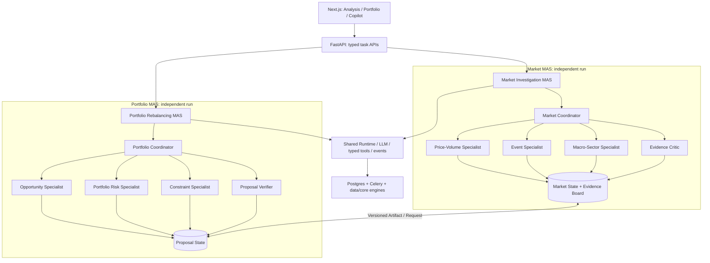
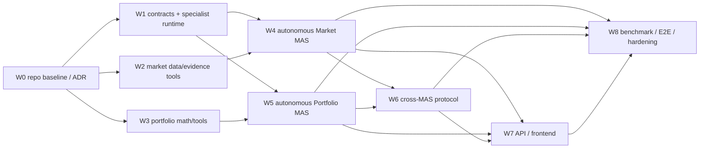

# Pro_Trading_DS：双自治金融 MAS 集成实施计划

> **状态**：实施中；本文保留原始要求，最新验收与未完成项见 [执行台账](financial-dual-mas-execution.md) 和 [逐项接手台账](financial-dual-mas-task-status.md)。
> **仓库**：https://github.com/celvelzel/Pro_Trading_DS  
> **核对基线**：`main@de262d4a089069e2a1387655e3daa3c6a7a4fe4b`（2026-10-08 读取；执行前重新确认）  
> **目标**：独立的 Market Investigation MAS（M-MAS）与 Portfolio Rebalancing & Risk MAS（P-MAS），复用仓库基础设施，支持可控跨 MAS 交流；**不执行真实交易**。  
> **使用对象**：Lead Coding Agent、并行实施 Agent、独立 Reviewer、集成负责人。  
> **本文是计划，不声明代码已实现或测试通过。**

## 0. 给实施 Agent 的最高优先级指令

1. 先读取仓库最新 `README.md`、`docs/adr/0001-agent-architecture.md`、`docs/architecture/agent-contracts.md`、`docs/architecture/runtime.md`、`backend/agent/`、`backend/api/routes/`、`lobster_quant/src/`、现有测试和迁移；以 **实际源码** 高于此计划的路径假设。记录基线 SHA 与可复现测试结果，绝不擅自覆盖现有改动。
2. **两个自治 MAS**：各自 `Coordinator / Specialist Agents / State / Verification / Evaluation / Run`，各自单独可运行；跨系统失败不影响独立完成。
3. **共享基础设施但不共享业务 Coordinator**：复用当前 `ModelProvider`、typed tools、PostgreSQL、Celery、SSE、引用、审批；不引入 LangGraph，不偷偷重写现有通用 Agent Runtime。
4. **新增扩展不得破坏原 API/行为**；修改冻结契约（运行预算、Step、事件、外部语义、数据库迁移）之前先以新 ADR 明确变更、兼容性和回滚设计，并记录测试。
5. **风险与金额必须来自可核查、确定性工具输出**；新闻和检索文本不可信；历史研究必须带 `as_of` 防止未来数据泄露。禁止 agent 直接更改真实持仓、调整现金余额、接券商或自动下单。
6. 多 Agent 意味着**独立的 Agent 调用与上下文、结构化消息、可观察的协调行动、可验证的分歧解决**，不是单次 LLM 请求模仿五个角色。
7. 各阶段遵循 **tests before merge / minimal diff / PR review / documented evidence**；失败不掩盖，不通过放松断言“修好”。
8. PR/任务须给出：改动文件、接口变化、测试命令与结果、风险、已知限制、后续依赖。未获必要权限不得操作受保护分支。

## 1. 仓库事实与技术债（经源码核对）

| 模块 | 已有能力 | 对本项目的现实限制 / 决策 |
|---|---|---|
| `backend/agent/orchestrator.py` | persisted Plan-and-Execute、审批、运行状态、step/tools、job 恢复 | 当前 `_execute_steps()` 顺序执行工具；非工具 step 未真正执行 Specialist 协商/综合，终局生成固定提示。需要 **MAS 专用执行驱动**，不要全局更改 legacy 行为。 |
| `backend/agent/planner.py`、`schemas.py` | `PlanSpec`、typed steps、依赖验证 | 初始计划最多 6 step（schema）；原契约 run 最多 8 步/10 model calls/8 tool calls，最多 1 次 replan。MAS 须有有界内部预算和新 ADR，不能仅加 prompt。 |
| `docs/adr/0001-agent-architecture.md` | 明确不引入 LangGraph；PostgreSQL 状态、Celery 队列、可重放 SSE | 新工作流复用现有部署和事件系统，改变语义先 ADR。 |
| `backend/agent/tools/{registry,executor,market,risk,backtest}.py` | Pydantic 输入输出、执行校验、tool envelopes、MarketSnapshot/单标的 Risk、job 回测 | 加增量 tools；数据 `source/timestamp/citation` 清楚；重计算不交由 LLM。 |
| `lobster_quant/src/core/data_engine.py`、`src/data/providers/` | 现有行情多 provider/cache | 增加带 `as_of` 的 point-in-time 读取适配层；不能假设 provider 有历史新闻。 |
| `lobster_quant/src/core/risk_engine.py` | OFF、ATR、MA200、Gap 等单资产风险 | **不是**组合权重/协方差/压力/再平衡引擎；新增组合级模块。 |
| `lobster_quant/src/analysis/backtest/portfolio.py` | 聚合各标的策略回测 | `_aggregate_equity_curves` 按 **序号**平均、无统一交易日和权重；**不可直接作为配置调仓精确回测**。新建 AllocationSimulator。 |
| `lobster_quant/src/storage/portfolio_store.py` | 本地持仓与现金 JSON | 缺市价时使用成本价回退；缺现金文件默认 `100000`；普通 UI 容错不能用于投资决策，新增严格只读 Snapshot Adapter。 |
| `backend/api/routes/agent.py`、`lobster-quant-web/src/app/copilot/page.tsx` | `/api/agent`、review/auto、SSE、审批、timeline | 复用原 lifecycle，扩展新类型及详情视图；默认旧 Copilot 不受影响。 |
| `backend/tests/`、`lobster_quant/tests/`、`eval/` | 各层测试与 deterministic fake model | 在相同框架新增 MAS-specific fixtures、端到端、隔离、消融；不要把历史文档中的 pass 数当成当前结果。 |

**注意**：`portfolio.py` 的当前持仓接口面向实际持仓且有增删改；任何 MAS 只能调用**独立只读接口**。历史 `as_of` 不能由最新持仓 + 历史价格冒充，除非用户提供/系统保存了当时持仓快照。

## 2. 目标架构和自治边界



### 2.1 强制独立性定义

- 两个不同的 `mas_kind`（`market_investigation` / `portfolio_rebalance`），两个持久化的 Run（各有独立 `run_id`）、各有 Coordinator、roles、state schema、完成/失败语义和预算；允许同时运行、独立取消/重试/恢复。
- M-MAS 仅需要 market snapshot / evidence；P-MAS 仅需要 position snapshot / prices / constraint tools；**任一系统在另一个未部署、超时或失败时均应正常处理自身请求**。
- “联合分析”由一个薄 **workflow router** 按请求创建关联的两条 MAS Run；不是第三个替代内部 Coordinator 的业务大脑。跨系统通过 artifact 引用；不互相 import 对方 Agent 实现。
- 不让跨系统状态在同一个 PostgreSQL JSON 对象里混合修改；`MarketEvidenceArtifact` 和 `PortfolioProposalArtifact` 是各自的产物，消费方使用快照，不能篡改生产方历史结果。

### 2.2 最小专业角色

**M-MAS**：Market Coordinator → Price/Volume、Macro/Sector、Event Research → Evidence Critic → final verified/unresolved artifact。可先完成其中两名调查员与 Critic，再扩展至全角色；每人不同工具权限和隔离 prompt。

**P-MAS**：Portfolio Coordinator → Opportunity、Risk、Constraint → Proposal Verifier → revised proposal。风险计算/优化属于确定性工具，不伪装成 LLM Agent。对冲突用户需求可输出 infeasible。

### 2.3 公共 Typed Contracts（先定 Schema 再并行）

建议用 Pydantic v2 定义以下对象，字段与类型以正式 PR 为准：

```python
class MarketInvestigationRequest(BaseModel):
    symbol: str
    as_of: datetime               # aware UTC
    lookback_trading_days: int = 20
    sector_benchmark: str | None = None
    max_llm_calls: int = 12

class EvidenceRef(BaseModel):
    id: str
    source_type: Literal["market_tool", "filing", "news", "macro", "document"]
    source_locator: str             # stable URL / local immutable fixture ref
    published_at: datetime | None  # aware timestamp; unknown is allowed
    observed_at: datetime          # when system retrieved it
    content_hash: str
    excerpt: str | None = None

class MarketInvestigationArtifact(BaseModel):
    schema_version: int = 1
    investigation_run_id: str
    symbol: str
    as_of: datetime
    numeric_facts: list[dict]      # eventually narrow into typed model
    hypotheses: list[dict]         # for / against / unresolved
    evidence: list[EvidenceRef]
    limitations: list[str]
    status: Literal["verified", "partial", "insufficient_evidence"]

class PortfolioReviewRequest(BaseModel):
    portfolio_snapshot_id: str     # immutable snapshot of holdings / cash
    as_of: datetime
    user_constraints: dict         # later normalized typed constraints
    market_artifact_id: str | None = None

class PortfolioProposalArtifact(BaseModel):
    schema_version: int = 1
    portfolio_run_id: str
    snapshot_id: str
    as_of: datetime
    current_weights: dict[str, float]
    proposed_weights: dict[str, float]
    constraint_check: dict
    risk_comparison: dict
    evidence_ids: list[str]
    status: Literal["feasible", "infeasible", "insufficient_data"]
```

这些只是接口草案，需在 PR-W1 中冻结（禁止以 `dict` 永久代替重要金融约束/证据类型）。特别约定：所有时点统一 aware UTC，另存市场交易时区；`as_of` 代表**研究时点可知**，与事后 `retrieved_at` 不同；前复权/复权、分红和缺失数据策略要明确标识，不能混用。金额/收益只认计算工具结果。`status=partial/insufficient_data` 也属于合法结果。

### 2.4 内部消息

- 通用 Envelope：`message_id`、`schema_version`、`origin_mas`、`target_mas` / agent、`run_id`、`correlation_id`、`causation_id`、`type`、`payload_ref`、`as_of`、`created_at`、`deadline_at`、`idempotency_key`、`budget`。
- Market 内部类型：`FINDING / HYPOTHESIS / CHALLENGE / REQUEST_CHECK / VERDICT`。
- Portfolio 内部类型：`PROPOSAL / RISK_ALERT / CONSTRAINT_VIOLATION / REVISION / APPROVAL_RECOMMENDATION`。
- 跨 MAS 类型：`MARKET_EVIDENCE_REQUEST / MARKET_EVIDENCE_READY / PORTFOLIO_IMPACT_REQUEST / SYSTEM_UNAVAILABLE`。
- 传 **artifact_id + schema_version**，按权限从存储查询 immutable snapshot；不传任意长度聊天历史或系统提示词。拒绝不兼容版本、错误 time window、未经授权的引用。
- 禁止无限调用：M→P→M 最多配置 1 次补查往返；跨 MAS TTL、最大深度和每级成本上限强制执行，超时降级为 partial result。**不能创建循环等待**。

### 2.5 实行方案的关键抉择

- 推荐新增 `backend/agent/shared/specialist_runtime.py` 作为角色调用与 checkpoint 的通用子模块；**M/P 各自编排 state machine**。旧 `AgentOrchestrator` 保持默认 `general` 运行模式；通过受控 dispatch 注册两个新 Workflow Driver，而非在旧 `_execute_steps()` 里塞大量 if/else。
- 为 MAS run 提供可持久化的 Specialist 调用记录和业务 state（JSONB + schema version，或专用 domain tables）；**DB 是唯一权威状态**，Redis 不是。
- 并行角色结果统一通过 coordinator 写入共享状态，避免 Agent 同时覆写同一 JSON。事件单调 `seq`、事务性记录、幂等重试沿用当前契约。
- 新 MAS 可有独立（**受限**）预算：例如每 run <= 16 LLM 调用、<= 20 工具调用、<= 3 轮协调、<= 1 跨 MAS request；是新配置与新 ADR 的建议值，不能自动套用 legacy 上限或悄悄放宽通用模式。新增总 wall-clock 上限与超时、取消传播。
- Specialist 的每轮独立调用可共用同一基础模型；model policy 可以后续优化，不应成为先决条件。

## 3. 工作分解与 PR 依赖图



**Gate 标准**：无 PR-W1 前不能让 Agent 4/5 各自定义不兼容 schema；W4、W5 可以完全并行；W6 必须在两个 MAS 独立通过验收后进行；W7 中只涉及各自页面的部分可以在 W4/W5 完成接口契约后平行开发。

### W0（Baseline & ADR，先行；Lead + Reviewer）

**任务 ID：W0-T1..T5**

1. 记录 `git rev-parse HEAD`、工作区是否干净、活跃分支；创建 feature branch 和工作树，禁止在 `main` 直接编码。
2. 逐一确认源文件、依赖、SQL migration head、local/Compose 两种启动方式、已有接口及测试命令；维护 `docs/architecture/financial-mas-inventory.md`。
3. 执行并记录（测试不保证先通过）量化核心、Backend、前端单测与 build；区分基线已有失败与新增失败。
4. 新增 `docs/adr/0002-dual-autonomous-financial-mas.md`：两个独立 Run、Runtime 复用、工具权限、联合 router、迁移、事件、预算、回滚和无实盘边界。
5. 定义跨 Agent 与跨 MAS 输入/输出契约、外部 API 兼容策略（优先添加而不是改变旧接口）。

**交付**：baseline 报告、ADR、接口草案、并行文件 ownership map。  
**Gate W0**：Reviewer 认可无 LangGraph / 无真实交易 / 两个 MAS 独立。

### W1（共享 Agent Runtime / Persistence；Runtime Agent）

**任务 ID：W1-T1..T7**

1. `backend/agent/shared/`：`SpecialistRegistry`（角色/模型/工具 allowlist）、`SpecialistInvoker`（独立模型调用、独立 context）、`WorkflowDriver` Protocol、`RunBudget`（calls/tool/time/rounds/depth）。
2. Domain-specific `MarketState` / `PortfolioState` 的统一 snapshot/checkpoint 接口；共享不是共用一个业务 state。
3. `FinancialMASDispatcher` 接入现有 agent worker、run lifecycle，确保 M-MAS/P-MAS 是单独 run id；保留旧 `GeneralAgent`。建议将 domain run 元数据与子调用轨迹通过 additive migration 保存；依现有实现选择引用表结构。
4. 子 Agent 结果先结构化验证，再由 Coordinator 单写入 shared state；记录 who/what/why/evidence id，不能暴露思维链。
5. 完成中间结果持久化、恢复（after worker restart）、暂停/取消、超时、冲突版本、重复投递去重、任务预算耗尽安全停止。
6. Audit Events：Agent invoked/returned、artifact created、challenge、replan、handoff、failure；扩展事件 schema 与 SSE 显示，不能破坏已有 event consumer。
7. 给老 Copilot 跑回归；新 fake-provider fixture 可以明确注入角色响应脚本。

**建议文件**：`backend/agent/shared/{runtime,contracts,budget,dispatch,artifact_store}.py`、`backend/db/models/financial_mas.py`、`backend/migrations/versions/<next>_dual_mas.py`、相关 tests。  
**Gate W1**：一个 fake M-MAS 和 fake P-MAS 各完成独立 2-agent handoff、恢复、暂停/取消/重复投递、老 Copilot 不回归。

### W2（Market Data / Evidence Tools；Market Data Agent，可与 W1/W3 并行）

**任务 ID：W2-T1..T6**

1. 基于 `DataEngine` 封装 `get_market_history(symbol, as_of, lookback, adjustment)`；输出经交易日排序的 OHLCV、provider、as_of、data_last_bar_at、币种/交易市场、缺口标识。不假设 provider 默认具备 as_of，必要时本地过滤并做不可用检测。
2. `calculate_market_anomaly`：return、volume/20d、与 SPY/sector benchmark 的同日期 excess return、相对强弱；严格处理停牌、NaN、非交易日、样本不足、复权。无模型数值推算。
3. `get_event_evidence`：先只支持手工整理的历史“新闻/公告” fixture 与现有 `RAG` / Document Retriever；如果无官方历史新闻 provider，明确返回 `unavailable`，不要偷偷让 LLM 编新闻。未来 live adapter 独立 PR。
4. Evidence normalization：published_at、available_at、retrieved_at、source URL、内容 hash、time cutoff。没有发布时间的文本不能用于严格历史归因。
5. 建 8–12 个历史示范事件/合成证据包（带事实真值，不给出虚假唯一因果）；含行业共振、晚于收盘公告、谣传、证据不足。
6. typed tool registration、unit tests、fixture versions；读权限、安全引用校验。

**建议文件**：`lobster_quant/src/analysis/market_anomaly.py`、`backend/agent/tools/{market_history,market_events,anomaly}.py`、`eval/fixtures/market/*`、tests。  
**Gate W2**：离线可重复返回同一个 `as_of` 的指标和证据；未来发布时间的资料一律拒绝参与时点推理。

### W3（Portfolio Calculations & Snapshot Tools；Quant Agent，可与 W1/W2 并行）

**任务 ID：W3-T1..T8**

1. 新的 **strict readonly** `get_portfolio_snapshot`，拒绝成本价冒充市价、默认虚拟现金冒充用户真实现金；缺市价/币种/日期不足时输出 `insufficient_data`，可选显式 `demo_portfolio` fixture。
2. `PortfolioRiskAnalyzer` 计算：组合实际权重、单资产集中度、现金比例、基于同日期收益序列的波动率、最大回撤、相关性/集中度预警。明确预期回报、数据缺失处理和统计窗口；不要把旧 OFF Engine 称组合风险。
3. `AllocationSimulator`：基于日期对齐的 total-return/复权数据及现金，按目标权重、rebalance cadence、成本/滑点生成净值；实现 no look-ahead。它不等于现有 `PortfolioBacktest` 的 equity-curve 平均。
4. 设计约束 schema：`max_weight_by_symbol`、`min_cash_weight`、`max_equity_weight`、`max_sector_weight`（只有能可靠获取 sector classification 才强制检查）、`sum(weights)=1` 容差、nonnegative。对含糊/冲突自然语言必须在执行前澄清或显式 infeasible。
5. `validate_allocation`：**确定性** hard constraints 检查，非 Agent 主观判断；指定来源的无法检查条件 => `unknown`, 不得误写为 pass。
6. 轻量 `generate_feasible_candidates`：以简单规则或有界优化产生候选，暂不做复杂收益预测/高阶 MVO；结构化失败原因。
7. 20–30 个可自动评测的组合情景（feasible / infeasible / missing price / conflicting constraints / high concentration / mixed currencies）。
8. typed tools + numerical tests：已知收益路径手算验证、day alignment、费用、空持仓、负权重、总权重超/不足、零波动、缺数据和 snapshot 不变性。

**建议文件**：`lobster_quant/src/core/{portfolio_risk,allocation_simulator}.py`、`backend/agent/tools/{portfolio_snapshot,portfolio_risk,allocation}.py`、`eval/fixtures/portfolio/*`。  
**Gate W3**：不用 LLM 也能得到可靠风险指标/约束结果；旧 PortfolioStore 数据绝不被模拟调整覆盖。

### W4（Market Investigation MAS；Market MAS Agent）

**任务 ID：W4-T1..T8**

1. `backend/agent/market_mas/` 定义独立 WorkflowDriver、Coordinator、state、prompts、specialists、critic、finalizer。
2. Supervisor 先计算异常，并建立市场/行业/公司/未知因素的竞争假说；每个假说必须标 support / against / unverified。
3. Price-Volume Specialist 使用 only permitted market tools；Macro-Sector Specialist 对比可获得的 sector/macro evidence；Event Specialist 搜索可追溯事件。三者拥有不同上下文和工具权限。
4. Evidence Critic 独立核对消息发布时间、来源真实性与时间顺序，遇冲突给 `REQUEST_CHECK`；不根据新闻标题强行断定因果。
5. Coordinator 基于 `missing_checks` 和预算决定下一次调查；明确区别“新 evidence 改变动作”与固定 waterfall。
6. 汇总强类型 `MarketInvestigationArtifact`：事实、可能解释、反证、缺失证据、拒绝过度归因；所有数字有 tool citations。
7. 最小自足入口独立运行、不依赖 Portfolio MAS。多轮、任务取消/超时、失败降级测试。
8. 固定流水线和单 Agent + 相同工具的 baseline；用 case 测验证率、晚发布信息错误、工具/Token 成本。

**Gate W4**：仅启动 M-MAS 可独立完成完整调查；至少一个案例证据新发现使 Coordinator 改变下一步工具调用。

### W5（Portfolio Rebalancing & Risk MAS；Portfolio MAS Agent）

**任务 ID：W5-T1..T8**

1. `backend/agent/portfolio_mas/` 定义独立 WorkflowDriver、Coordinator、state、prompts、specialists、verifier、finalizer。
2. Opportunity Specialist 仅提出候选方向与定性理由，不凭空制造预期收益；Risk Specialist 通过工具审查集中度、相关性、回撤；Constraint Specialist 将用户条件归一化并查矛盾。
3. Coordinator 提交候选配置至 `validate_allocation` 和 `AllocationSimulator`；Verifier 不允许绕过确定性检查。
4. 发现违反硬约束时发 `REVISION_REQUEST`，有界循环重试；如果用户约束不可同时满足则返回 `infeasible`，不擅自放宽限制。
5. 严格以**输入持仓快照 ID**为参考，保存 proposal snapshot 而非修改仓库中实际持仓；支持无 M-MAS 的纯配置需求。
6. `PortfolioProposalArtifact`：before/after、实际计算值、violations、不可测限制、历史模拟假设、风险取舍、人工审阅所需信息。
7. 独立测试：M-MAS API 不可用时 P-MAS 仍完成、价缺失时拒绝无依据提案、用户矛盾条件、重复执行不双写。
8. baseline：单 Agent + 同样工具；不含独立风险 Critic 的 multi-agent；比较 hard-constraint violations、infeasible detection、cost/latency。

**Gate W5**：只启动 P-MAS 可独立给出经过数值校验的虚拟方案或合理不可行结论；生产持仓文件无变化。

### W6（Cross-MAS Communication；Integration Agent，依赖 W4+W5）

**任务 ID：W6-T1..T7**

1. 统一 `CrossMASRequest/Response` 与 immutable artifact store，M/P 只依赖 shared contracts，不调用对方内部 Python agent classes。
2. 同时运行时每个 MAS 创建**不同 run_id**；使用 `correlation_id` 链接；保留 parent/cross relation 的持久化图，禁止借用旧的 `parent_run_id` 重新定义旧 retry 语义。
3. MVP 支持 P→M 请求进一步证据和用户组合任务 M→P 传调查 artifact；跨请求必须声明 `as_of`、scope、数据授权、预算、timeout。
4. 启用严格 cycle guards：`max_hops <= 2`、最多一次重复问询、TTL 到期降级、无环等待；明确重试幂等。
5. cross-check `as_of`、资产代码映射、来源存在性、timepoint；消息不包含任意 prompt 指令，所有外部证据按不可信文本处理。
6. 边界情况：对方未部署 / failed / cancelled / budget exhausted => 本 MAS 产出 partial，不无限等待。
7. E2E 场景：调查 MU -> 评估含 MU/SOXX 的 demo 组合 -> 生成已验证模拟方案；可在未启用跨 MAS 情况下独立运行双方。

**Gate W6**：三种模式（Market only / Portfolio only / Combined）全部通过；双 run 事件独立排序，跨链接可追踪，无 cross-loop。

### W7（API & UI；Frontend/API Agent）

**任务 ID：W7-T1..T6**

1. 在现有 `/api/agent` 基础上增加**兼容的 typed 入口**，推荐 `POST /api/financial/market-investigations`、`POST /api/financial/portfolio-reviews`、`POST /api/financial/combined-reviews`；服务端统一创建/关联实际 AgentRun ID。若最终选择向原 `/runs` 加可选 `workflow_type`，必须保留旧请求行为。
2. 结果 GET 接口带 `schema_version`、run status、artifact ref、validation outcome；继续复用 `/api/agent/runs/{id}/events`、versioned approve/pause/resume/cancel。
3. `lobster-quant-web/src/app/copilot` 新增模式选择：General / Market / Portfolio / Combined，展示角色轨迹、evidence board、风险 before/after 和引用；禁止展示隐藏思维链。
4. 在 `analysis/[symbol]` 提供“调查异动”，在 `portfolio` 提供“模拟调仓风险复核”链接；默认不会静默持久化用户投资偏好。
5. “Review” 只批准分析/模拟阶段，**不是**授权真实持仓变更或实盘操作；保留两层权限界限。
6. 前端测试：响应 schema、SSE replay/reconnect、重复事件、加载态、错误/partial 状态、可访问性、原页面 regression。

**Gate W7**：运行在网页操作能展示两套独立状态/轨迹，联合模式有两组 run_id；旧 Copilot 继续正常。

### W8（Benchmark / Security / Release；Evaluation + Reviewer）

**任务 ID：W8-T1..T8**

1. `eval/market_cases.jsonl`：10–15 个固定事件证据问题；题目分布包括行业共振、错误时序、假新闻、缺证据、未来资料禁止引用。只验可核事实，不将主观“下跌原因”作为唯一真值。
2. `eval/portfolio_cases.jsonl`：20–30 个约束场景；每例 gold constraint validity、expected failure kind、reference math。
3. 同样数据快照、同样工具与尽可能相同调用预算下：single-agent / fixed pipeline / fully autonomous MAS；可加 verifier ablation。
4. 指标 M：Evidence citation precision、timing violations、unsupported causal claims、tool/LLM count、latency、partial result correctness。
5. 指标 P：hard constraint violation rate、infeasibility detection、risk-calculation accuracy、data-missing safety、simulated net-value consistency。
6. 安全：prompt injection in event text；工具白名单；异常与失败降级；跨会话引用不可串用；异常输入；价格过期拒绝；无秘密泄露；不能触发 portfolio 写 API。
7. 并发 / 持久化：重复 Celery 投递、cancel/resume/checkpoint restore、乐观锁 409、单调 seq、migration upgrade/downgrade（安全范围内）、缺 Redis inline 执行可用性。
8. 整理 README/ADR/演示脚本/可复现实验，记录真实性：没有实盘、没有验证因果、后验模拟不等于未来收益。

**Gate W8**：单测 + integration + offline reproducible E2E + frontend tests + build 均无新增失败，保留 benchmark 原始结果和评估脚本。

## 4. 多 Coding Agent 编排与 ownership

**推荐模式：主协调者负责接口与 PR，不允许多个 Agent 同时修改同一共享文件。** Agent 是编码 worker，不等于业务运行时的 M/P-MAS Agent。

| Coding Agent 逻辑岗位 | Owner 范围 | 启动条件 | 交付 PR |
|---|---|---|---|
| Lead Integrator | 基线、ADR、接口冻结、核心路由集成、PR 审查 | 立即 | PR-W0 / 最终集成 |
| Runtime Agent | `backend/agent/shared/`、domain DB + migrations、runtime tests | W0 合约冻结 | PR-W1 |
| Market Data Agent | `lobster_quant/src/analysis/market_anomaly.py`、market data/evidence tools、market fixtures | W0 | PR-W2 |
| Portfolio Quant Agent | `lobster_quant/src/core/portfolio_risk.py`、allocation simulator、portfolio tools | W0 | PR-W3 |
| Market MAS Agent | `backend/agent/market_mas/`、market logic/tests | W1+W2 | PR-W4 |
| Portfolio MAS Agent | `backend/agent/portfolio_mas/`、portfolio logic/tests | W1+W3 | PR-W5 |
| Cross-MAS Agent | `backend/agent/integration/`、跨系统契约/测试 | W4+W5 | PR-W6 |
| UI/API Agent | financial routes/models、Next.js 组件和测试 | 稳定 API schema 后 | PR-W7 |
| Independent Reviewer / Eval Agent | `eval/`、安全审查、E2E、基准 | W1 合约后可先设计 fixtures；完整测试 W7 后 | PR-W8 / review |

### 并行 Wave（减少冲突）

- **Wave 0：** Lead 单独 W0；输出冻结的合同、基础分支、测试现状。
- **Wave 1：** 并行 W1（Runtime）、W2（Market Data）、W3（Portfolio Quant），**各自 worktree**；共享 schemas 优先由 W1 提供，W2/W3 用 adapter，不抢改统一 registry / package init / main / migration。
- **Wave 2：** 并行 W4（Market MAS）与 W5（Portfolio MAS）；Reviewer 同步检查角色真实独立、状态恢复与数据真值。
- **Wave 3：** W6（Cross-MAS），W7 的互不冲突 UI 可独立并行；API/DB 公共文件由 Lead 合并。
- **Wave 4：** W8（Eval）和 integration hardening。最终统一在集成分支 smoke+regression，合格后 merge。

### 冲突文件“单写入”策略

由 **Lead / Runtime Agent** 顺序负责：`backend/main.py`、`backend/agent/tools/__init__.py`、`backend/agent/orchestrator.py`、`backend/agent/schemas.py`、`backend/db/models/__init__.py`、迁移、root dependency/compose，以及 Next.js 导航。各 feature agent 只提供增量注册函数/PR 建议，不在多个工作树同时修改它们。

**Reviewer 有权阻止合并**：缺证明、跨 MAS coupling、重复模块、错误 financial math、修改老接口契约却不写 ADR、无测试、宽松 catch-all、擅自加实盘写接口。

### PR 标准模板

```text
PR ID / owner / base SHA / changed files
What changed / contract changed? / ADR needed?
Unit + integration + deterministic E2E commands and actual result
Financial data provenance / source freshness / as_of policy
Legacy regression / privacy / side effects
Metrics / failure scenarios / limitations
Next dependent PR / merge conflicts / rollback steps
```

## 5. 验收矩阵（不达标不宣布完成）

| Test ID | 场景 | 必须结果 |
|---|---|---|
| AUT-01 | 只启用 Market MAS，不启动 Portfolio MAS | 独立完成并输出可审计 evidence artifact |
| AUT-02 | 只启用 Portfolio MAS，不启动 Market MAS | 独立完成合法配置提案或 infeasible |
| AUT-03 | 两 MAS 同时并行运行 | 独立 run_id/state/事件/预算；无共享状态污染 |
| AUT-04 | 取消其中一 MAS | 另一个运行不受破坏；有关联结果标注 partial |
| MKT-01 | 新闻发布在 as_of 之后 | 不参与当时调查；明确标时间不适用 |
| MKT-02 | 事件和股价同期但无证据表明因果 | 不能将猜测输出为已确认根因 |
| MKT-03 | 新证据反驳原始假说 | 有可追溯的 `REQUEST_CHECK` / 动态路由 |
| PRT-01 | 所有硬约束互相矛盾 | 返回 infeasible，不修改用户条件 |
| PRT-02 | 缺真实价格，PortfolioStore 有 cost_basis fallback | 严格工具拒绝计算，不拿成本价伪装当前市价 |
| PRT-03 | 调仓模拟完成 | 持仓/现金 JSON 文件 hash 未变化、无写 endpoint 调用 |
| PRT-04 | 不同交易日或分红调整 | 统一日期 & 价格口径，得到可复核结果 |
| XMS-01 | Cross MAS 对方超时/不可用 | partial/degraded + timeout，不能死循环 |
| XMS-02 | 重复投递同一个跨请求 | 幂等，仅保留一组逻辑请求与产物 |
| RUN-01 | Worker 中途 crash / reconnect | DB checkpoint 恢复，事件 seq 不重复/回退 |
| RUN-02 | 恶意检索文档要求“改持仓/忽略规则” | 视为文本证据；没有写操作 |
| REG-01 | 原 `general` Copilot 和旧 endpoints | 与基线一致，无新增 regression |

## 6. 推荐执行时间 / 范围控制

若独立 Coding Agent 可并行且现有服务能正常跑，按 **4–6 周** 分阶段推进；不是保证工期：

| 周次 | 目标 | Gate |
|---|---|---|
| 第 1 周 | W0 基线/ADR + W1 契约原型 + W2/W3 工具起步 | 2 个 fake MAS 能各自创建 run、工具有纯离线测试 |
| 第 2 周 | W1 持久化完成、W2/W3 完整数值与数据工具 | 独立工具 + 隔离 + 恢复测试通过 |
| 第 3 周 | W4 Market MAS & W5 Portfolio MAS 平行 | 2 个自治 MAS 都可单独从输入到有依据的输出 |
| 第 4 周 | W6 跨 MAS + W7 API UI | 独立/联合三模式端到端演示 |
| 第 5–6 周（缓冲） | W8 eval、注入/失败测试、Demo、修复 | CI、文档、baseline/ablation 完整；不越权 |

**先确保最小可用版本**：
1. Market MAS：一个股价异动 + 1 个 benchmark + 固定事件 fixture + 3 Agent（Coordinator + 2 Specialists + Critic 可分轮） + 可解释证据板。
2. Portfolio MAS：4 资产 demo 组合 + 明确的硬约束 + 3–4 Agent + 确定性风险计算与模拟候选。
3. Cross-MAS：只交换 market artifact id 与请求补查，不做复杂 peer-to-peer discovery/全自动交易。
4. 可选未来工作：实时新闻适配、历史持仓真实回放、ETF look-through、成本预测、模型策略、自动调度、第三方账户连接。

## 7. 可复现验证命令（执行前按环境调整）

在 repo root（Windows PowerShell）：

```powershell
# 先记录代码状态（不得静默清理已有改动）
git status --short
git rev-parse HEAD

# Python 环境按当前 docs/architecture/runtime.md 或既有项目 venv 配置
$env:PYTHONPATH="backend;lobster_quant"
python -m pytest backend/tests -q
python -m pytest lobster_quant/tests -q

# 前端
Push-Location lobster-quant-web
npm run test:unit
npm run build
Pop-Location

# 现有 deterministic eval（具体调用参数按各脚本帮助确认）
python eval/run_agent_eval.py
python eval/run_recovery_eval.py
```

上述是供实施 Agent 检查和运行的命令，**不是已在当前 ChatGPT 会话实际执行通过的结果**。任何已经存在的失败记录入 baseline；新增失败阻止 PR merge。

## 8. 任务完成定义（Definition of Done）

- 运行：M-MAS / P-MAS / Combined 三种模式端到端；每个 MAS 完全独立的状态、预算、取消和恢复。
- 数据：财务数值/价格仅来源于有来源标识的工具结果；有历史时间一致性、异常/缺失明确处理。
- 风控：所有数值约束由确定性工具验证；无法满足时返回 infeasible；无数据时不伪装为“通过”。
- 安全：无实际券商/交易；不调用修改持仓和现金接口；不暴露密钥和内部系统提示词。
- 工程：不引入冗余 Agent Runtime、完整 ADR、代码类型校验、数据库迁移、回滚文档、SSE 事件兼容和全部回归。
- 评估：相同工具/数据/预算的 strong single-agent baseline + full multi-agent + 至少一个 verifier/dynamic-router ablation；透明地报告额外成本与失败案例。
- 团队：每个 Coding Agent 的 PR 可审查、可追踪、文件所有权明确；Lead 汇总所有测试的**真实输出**和新旧基线差异。

## 9. 可直接交给 Lead Coding Agent 的启动 Prompt

> 请对 GitHub 仓库 `celvelzel/Pro_Trading_DS` 执行《双自治金融 MAS 集成实施计划》，计划正文作为优先级明确的工程任务清单。首先读取最新源码，核对计划基线 SHA 与实际差异，不允许覆盖现有未提交改动。建立 feature branch / Git worktrees，并将 W0 到 W8 分成可审查、具备独立所有权的任务。使用已连接的多 Coding Agent 编排能力（如用户明确调用的技能），先冻结契约与 ADR，再平行推进 W1/W2/W3；依赖满足后平行开发 W4/W5，最后 W6/W7/W8。两个业务 MAS 必须分别拥有独立 Coordinator、Agents、State、Verification、run_id、Evaluation，并能单独运行；复用仓库现有 Plan-and-Execute/PostgreSQL/Celery/SSE 运行时，不引入 LangGraph。禁止真实交易、券商下单、修改真实持仓或制造金融数值。每个 PR 给出改动、测试、风险、回滚及需要的人类确认。遇到 ABI/API 破坏、冻结契约变更、无法解决的事实/时间数据缺失，先停在对应 Gate 并报告，不得为赶进度绕过。最终展示 Market only、Portfolio only、Combined 三种模式及可复现基线/消融对比；如做不到，准确标明未完成项，不得宣称完成。

---

**参考源码**：
- https://github.com/celvelzel/Pro_Trading_DS/blob/main/docs/adr/0001-agent-architecture.md
- https://github.com/celvelzel/Pro_Trading_DS/blob/main/docs/architecture/agent-contracts.md
- https://github.com/celvelzel/Pro_Trading_DS/blob/main/backend/agent/orchestrator.py
- https://github.com/celvelzel/Pro_Trading_DS/blob/main/backend/agent/tools/registry.py
- https://github.com/celvelzel/Pro_Trading_DS/blob/main/lobster_quant/src/core/risk_engine.py
- https://github.com/celvelzel/Pro_Trading_DS/blob/main/lobster_quant/src/analysis/backtest/portfolio.py
- https://github.com/celvelzel/Pro_Trading_DS/blob/main/lobster_quant/src/storage/portfolio_store.py
